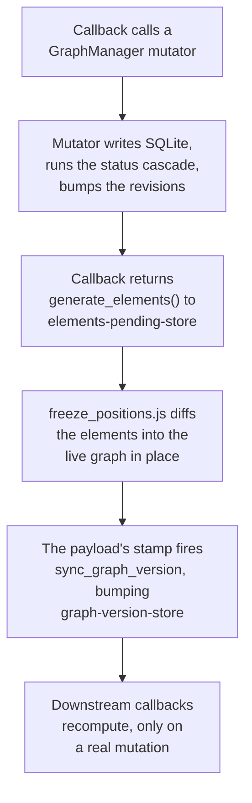

# App Architecture

How the app fits together: its layers, where code lives, how the pieces talk, and the rules that keep them working. Node and edge semantics and the must-know rules are in [AGENTS.md](../AGENTS.md). The scoring and time math are in [scoring.md](scoring.md) and [time.md](time.md). What things cost, and how they got that way, is in [performance.md](performance.md).

## Layers

The app is the `skilltree/` package. The root `app.py` only launches it.

| Layer | Folder | Holds | May import |
|---|---|---|---|
| Domain | `domain/` | Pure logic: models, scoring, time, names, contexts, rules | Domain only |
| Runtime | `runtime/` | Paths, the version, the server, the opener | Runtime only |
| Store | `store/` | SQLite and everything that reads or writes it | Domain, runtime |
| UI | `ui/` | Dash pieces two or more features share | Domain, runtime, store |
| Feature | `features/<name>/` | One feature's layout and callbacks | The layers above, and itself |
| Composition | `app.py`, `services.py`, `shell.py`, `engine/` | Tying the features together | Anything |

`tests/app/test_architecture_boundaries.py` enforces these imports, and four more rules:

- No module imports another module's `_private` names, or reads them as `module._name`.
- Only `skilltree.app` imports skilltree modules inside functions. A launch that hands over to a running instance then exits before loading Dash.
- `__init__.py` files stay empty.
- Importing a module opens no database and configures no logging.

Features never import each other. They coordinate through the database: a write bumps a revision, and every view notices on its next callback. What crosses features, such as the core engine or the page layout, sits in composition.

## The package

```
skilltree/
  app.py        create_app and main: environment, logging, schema, startup repairs, registration
  services.py   AppServices: the one GraphManager and EventManager
  shell.py      the page: its template with the startup cover, and the layout assembled from features
  engine/       the core callback: router, handlers, response, sidebars, and the modals it opens
  domain/       models, scoring, synergy, profiles, goals, simulation, time, names, rules, contexts, communities
  runtime/      paths, version, server, perf, opener, file_picker
  store/        database, schema, settings, events, resources, backup, transfer, commands
    graph/      manager (the state gateway), repository, queries, scoring, state, taxonomy
  ui/           tokens, styles, kit, dash_tools, payloads, prerender, filters, sidebars, tabs, timing
    canvas/     registry, elements, view, settings_panel, tooltip, callbacks
    components/ context_picker, list_toolbar, duration, menus, ratings_table, confirm
  features/     analyze, details, editor, events, filters, goals, home, links, nodes,
                onboarding, review, settings
assets/         boot scripts at the top, feature folders, css/, vendor/
```

A feature package has a `layout.py` and a `callbacks.py`. `callbacks.py` exposes `register_<feature>_callbacks(app, services)`, which also registers the feature's other modules. Larger features split by panel: the editor has `form.py`, `save.py`, `dormancy.py` and `resources.py`, and Details has `explain.py`, `simulation.py` and `subtasks.py`.

Some store modules carry most of the weight:

- `store/graph/manager.py` is the state gateway. It owns the graph's public API, transaction boundaries, status cascades and completion notifications. SQL goes through `repository.py`, traversals through `queries.py`, scoring through `scoring.py`, and taxonomy remaps through `taxonomy.py`.
- `store/graph/state.py` owns the process-wide revisions and each manager's caches.
- `store/events.py` is the same for the Events table. It owns the awake/dormant rule and the one-Event-per-node rule.
- `store/settings.py` declares each stored setting once, as a `Setting`: its key in the Settings table, its default, how its text reads and writes, and whether writing it redraws the graph.
- `store/commands.py` holds the mutations the editor and the menus run: save, delete, Done, links and bridges.
- `store/database.py` and `store/schema.py` hold connections, snapshots, transactions and the refusal errors; and the tables at the one schema version the app opens.

## Composition

`create_app(app_settings, services)` builds one app:

1. It selects the database (`paths.ENVIRONMENT`) before opening SQLite. A process can't switch databases later.
2. It configures logging, runs `schema.init_db`, seeds the node types and runs the status repair.
3. It builds Dash with the page template from `shell.build_index_string`, which carries the startup cover, and installs the canvas registry.
4. Its layout factory builds the page under one read snapshot, then prerenders the marked callbacks into it.
5. It registers the engine, the shared ui pieces and every feature from one list, in order. A new feature adds one entry.

`AppServices` builds one `GraphManager` and an `EventManager` on it. It connects two listeners: a completed node fires the events watching it, and a narrowed trigger set fires its event if the rest are already Done. A bare `GraphManager()` fires no events. Callbacks get their managers from `services`, and no module builds one of its own.

Importing `skilltree.app` does none of this. Tests replace `database.get_db_path` before building an app on disposable data.

### The core engine

One callback, in `engine/callbacks.py`, saves, deletes, toggles Done and renders the Nodes canvas, so each action is one request. It only routes:

1. Gates come first. A switch to a tab other than Nodes, or an editor open or close, sends only what changed.
2. `handlers.handle(Request(...))` runs the handler for the trigger: save, delete the loaded node, toggle Done on a tap or a selection, confirm undo-Done, or group delete. A handler returns an `Outcome`: a message, the completed node, the undo-pending names, or a whole early response.
3. The shared render builds the canvas view, and the outcome merges into a `CoreResponse`.

Its inputs, state and outputs are dicts keyed by name. The outputs are `CoreResponse`'s fields (`CORE_OUTPUTS` in `engine/response.py`). Dash merges the inputs into the state dict it is given, so the engine passes a copy. A render that only the filters fired sends only the view.

The editor's save transaction is `save_editor_form` in `features/editor/save.py`. It doesn't touch Dash, and it raises `ReopensDoneNodes`, `ValueError` or `TypeError` for the handler to report.

## State flow: stores are the wiring

`dcc.Store` components, declared in the layouts, pass data between server callbacks and the browser without coupling them. The load-bearing ones:

- `graph-version-store` mirrors `revisions.graph`. Callbacks that subscribe to it recompute only when the graph really changed.
- `elements-pending-store`, and its `details-` and `events-` variants, take each canvas's new elements. Callbacks never write Cytoscape's `elements` directly.
- `canvas-payload-stamp` records each Nodes render: whether the canvas has loaded, its node count, and when. Server callbacks listen to it instead of to the elements, which as an Input would send the whole canvas back.
- `freeze-rerender-store` and its variants hold each canvas's freeze switch.
- `editor-pristine-snapshot` holds the form as it loaded, for the unsaved-changes check.
- `editor-save-result-store` is written once a save commits (`{name, via, ts}`). Every follow-up to a save acts on it, never on the click.
- The `*-pending-store`s, `focus-goal-store` and `selected-suggestion-store` carry state across the steps of confirm flows.

Write a store only when its value changes. Dash re-fires every dependent callback on a write, even of the same value, so a refresh that rewrites a selection store looks like a new selection.

## The mutation → render loop

Almost every edit takes this path. Get it wrong and the canvas either doesn't update or jumps.

1. A callback calls a `GraphManager` mutator: `add_node`, `update_node`, `add_edge`, `sync_edges` and the like.
2. The mutator writes SQLite, runs the status cascade if the change affects status, and bumps the revisions.
3. The callback returns `generate_elements(...)` to `elements-pending-store`.
4. `assets/canvas/freeze_positions.js` diffs those elements into the live graph in place. It keeps the positions nodes have and seeds new ones near their neighbors. Replacing the whole `elements` list would relayout the graph on every edit.
5. A clientside callback stamps the payload into `canvas-payload-stamp`. The stamp fires `sync_graph_version`, which bumps `graph-version-store` only if `revisions.graph` advanced.



Transactions:

- A compound save runs in `database.transaction()`. Nested manager and settings writes share one request-local connection, and only the outer scope commits.
- `BEGIN IMMEDIATE` serializes writers. Deferred foreign keys let a rename stay atomic without turning integrity checks off.
- A failed nested operation marks the whole save for rollback, even when a callback catches the error to show it.
- Revision bumps and completion notifications wait for the commit. A rejected save publishes neither.
- A save that would reopen Done nodes compares the Done sets inside its transaction, raises `ReopensDoneNodes` to roll back, and asks first. The link menu does the same through `link_change_reopens`.
- Settings commits one complete draft. `assets/settings/settings_close.js` routes every dismissal through one save request, and the dialog closes only after the commit.

What each canvas shows:

- `generate_elements` (`ui/canvas/elements.py`) decides the Nodes canvas: filtered nodes and the edges between them. Details and Events choose their own nodes, and redraw on `graph-version-store`.
- Every canvas builds elements with `build_node_element` and `build_edge_element`, so a node looks the same everywhere. A canvas passes only what is its own: selection, Events' attached flag, Details' view root.
- Elements carry the fields in `CANVAS_NODE_FIELDS`, which names each field's reader.
- The browser owns the selection. A render sets it only when asked to show one node; every other render passes `KEEP_SELECTION`.
- Until the Nodes canvas loads on its first visit, the engine sends `CANVAS_DEFERRED` in place of its elements. The stamp still fires.

## The node editor

There is one node editor, and every way of opening it runs `populate_editor`.

- `EDITOR_FORM` (`features/editor/form.py`) declares the form's fields once. A callback that reads the form takes it as one grouped State and receives a dict.
- `populate_editor` returns `EDITOR_FILL`'s outputs by name. It fills the form from a snapshot, `build_editor_snapshot` for a node or `NEW_NODE_SNAPSHOT` for a blank form, and keeps that snapshot as the pristine copy. So a node that was only loaded never counts as edited.
- Loading another node asks before dropping unsaved edits. The dialog stores where it was going in `pending-navigation-store`: a node's name, or a sentinel (`__new_node__`, `__new_subtask__|<parent>`, `__bridge__`, `__background__`).
- The dialog's Save moves on only after its own save commits. `sync_original_name_after_save` adopts a saved name only after Save.
- `bridge-pending-store` holds the link a bridge replaces. Every load of the editor rewrites it, and the save removes the link only for a new node that really sits between the two ends.
- Dormant is a field of the editor, saved with Save. `features/editor/dormancy.py` fills the section from the database and collects it into `node-dormancy-form`. A refusal rolls back the whole save.

## The browser

`assets/` holds the browser's half: context menus, freeze, layout requests, sortables, covers.

### The JS–Dash bridge

Page scripts talk to Python through hidden inputs and stores.

- `SkillTree.setInputValue` in `assets/00_browser_bridge.js` writes a hidden input through the native value setter and a synthetic `input` event. A plain `el.value = x` is ignored, because React controls the input.
- A value is suffixed with `|` and a timestamp, so editing the same node again still changes it. `ui/payloads.py` reads these values, so a name containing `|` reads back whole.
- The bridge also owns `SkillTree.getCy`, the one boundary to Cytoscape's private DOM registration, and `SkillTree.wrapLayout`, which composes each canvas's layout hooks.
- A context menu's Edit routes by source. The Nodes canvas writes `edit-trigger-input`, which switches to that tab. Everything else writes `details-edit-trigger-input`, which opens the editor in place.

### How assets load

- Dash loads the files at the top of `assets/` first, then each folder in name order. Only the boot scripts sit at the top: the `00_` and `01_` files, `native_builtins.js`, `store_mount.js`, `startup_cover.js`, `window_chrome.js` and the dev-only `hard_reload_on_restart.js`.
- Feature scripts sit in their folders: `analyze`, `canvas`, `components`, `details`, `editor`, `events`, `home`, `menus`, `settings`, `sidebars`.
- A script that calls another's `SkillTree` function as it loads must load after it. `tests/app/test_asset_order.py` runs every script in Dash's order against a stand-in for the browser, and fails on any that throws.
- Stylesheets sit in `assets/css/`, so they load in name order, the order their cascade was written for.
- Dash skips any folder whose name contains "vendor". `assets/vendor/` holds the third-party files, each with its license. `app.VENDOR_STYLESHEETS` loads their CSS ahead of the app's own.
- The canvas list reaches the page before any asset runs, in an inline script from `ui/canvas/registry.py`: `window.SkillTree.canvases`.
- A clientside callback longer than a few lines lives in its feature's asset, as `window.dash_clientside.<namespace>.<name>`. The Python refers to it with `ClientsideFunction`.

## Status cascade and history

- Marking a node Done, or changing a hard prerequisite, calls `update_node`. It walks forward along `Needs_Hard` out-edges, and each dependent becomes Blocked or Open.
- Goals keep the status the user set. A Done Milestone never re-blocks (`_KEEPS_DONE_TYPES`).
- A Goal whose hard children just became all Done is queued for the auto-Done prompt (`pop_auto_done_candidates`). The app suggests; it never marks the Goal itself.
- `recompute_all_statuses` runs the same logic over the whole graph, as the startup repair.
- `NodeLifecycleEvents` is the append-only history of Now, completion and reopen crossings, in UTC seconds. A `now_started` row carries the node's place in the ranking just before it entered Now.
- `NodeLedger` records each node added and deleted. Nothing reads it yet.

## Scoring and the Next ranking

`features/home/view.py` asks `GraphManager.calculate_priority_scores` for the ranking. `store/graph/scoring.py` keys its memo on the database, the scoring revision and the hyperparameters. On a miss it calls the pure `domain/scoring.score_nodes`, which scores the whole graph, so filtering can't change a node's number. `get_priority_normalizer()` gives every view one common base. Explain and the ranking share the same contribution arithmetic.

## Revisions and caches

`revisions` in `store/graph/state.py` holds two process-wide counters. They publish on commit, and a rollback publishes neither.

- `revisions.graph` bumps on any node or edge change. It keys `graph-version-store`, the goal-subtree cache and the community cache.
- `revisions.scoring` bumps only when a field in `SCORING_RELEVANT_FIELDS` changes. It keys the scoring memo. A cosmetic edit leaves the memo warm.
- A setting with `refreshes_graph` bumps `revisions.graph` when written.

When you add a scoring-relevant field to `Node`, add it to `SCORING_RELEVANT_FIELDS`, or scores go stale.

Reads:

- Settings have no persistent cache.
- Hot read operations share one `database.read_snapshot()` (or `@database.snapshot_read`): Nodes, Edges, Settings and pending-trigger rows, read in one transaction that closes before rendering. A local write invalidates it, and it ends with the operation.
- Within a snapshot, each node row is normalized once and every read gets its own copy.
- Each manager owns one `GraphCaches`: at most 32 community entries and 128 subtree entries, dropped when the graph moves on.

## Startup and the server

### Refusals

`schema.init_db` refuses a database it can't safely open, and leaves the file untouched. `main()` exits with the refusal's code, which is how the desktop shell tells the cases apart:

| Code | Refusal | The user's way out |
|---|---|---|
| 2 | `DatabaseError`: saved by an older version, which this one doesn't upgrade, or any other SQLite failure while opening | Report it with the log |
| 3 | `NewerDatabaseError`: saved by a newer version | Install the newer version |
| 4 | `DatabaseCorruptError`: SQLite calls the file damaged | Restore a backup |
| 5 | `SQLiteTooOldError` | A build with a newer SQLite |
| 6 | `DatabaseLockedError`: another program holds the file | Close that program |
| 7 | `DatabaseUnwritableError`: read-only, no permission, or disk full | Fix it and relaunch |
| 8 | Another Skill Tree owns this database | It hands over to that one |

Only code 4 may lead to a restore. `database.refusal_for` maps SQLite's error names, so a busy or read-only file is never called damaged. Before exiting 4, the server names the newest backup at the current schema that passes `quick_check` on stdout. On the user's yes, the shell starts it again with `--restore-backup`. `backup.restore_over_damaged` restores only if the file is still damaged, keeps a copy of it, moves any journal aside, and swaps the backup in one step.

### How the server runs

`runtime/server.py`:

- One server per database. `InstanceLock` holds an OS lock on `<db>.lock`, taken before `init_db`. A second launch hands over: a browser launch opens the owner's link, and a desktop launch prints `SKILLTREE_RUNNING` and exits 8.
- The server binds 127.0.0.1 and prints `SKILLTREE_READY port=<n>` once it can answer. The shell reads that line rather than guessing a port.
- `AccessGuard` runs ahead of Dash. The Host header must name the server, which defeats DNS rebinding. Graph-bearing requests need the per-launch token, which the page keeps in `sessionStorage` and sends as `X-Skill-Tree-Token`. A changing request that names an Origin must name the server's own.
- When the desktop shell closes the server's stdin, the server finishes its requests and exits. SIGTERM and Ctrl+C do the same.
- `--dev` swaps in Flask's debug server with hot reload. It is for developers only, and a frozen build ignores it.

### Startup readiness

The page opens behind a cover, in the page template, so it is in the first paint. `assets/startup_cover.js` keeps the app `inert` until two things hold: the core engine's first response has landed, and Dash has had nothing pending for 150 ms. A 20 s backstop lifts it regardless.

Everything the cover waits for adds to the wait, so startup does as little as it can:

- A callback marked `@prerendered` (`ui/prerender.py`) runs its page-load call on the server while the layout is built, and never in the browser. `create_app` fails if a marked callback would also run in the browser.
- `populate_editor`, the Next table and the Now section don't run on load. The layout already holds what they would send.
- `assets/store_mount.js` stops a mounting in-memory Store from reporting a change.
- The core engine's page-load answer leaves out the resets the layout already holds.
- Analyze and the Nodes canvas render on their first visit. The Goals list builds once its sidebar's open slide finishes.
- `assets/native_builtins.js` puts back the browser's own `trim`, `parseFloat` and `parseInt`, which Dash's polyfill replaces with slower ones.
- NetworkX is imported where community detection needs it, and `main` warms it while the window opens.

Every callback costs about a dozen Dash store updates, and each update re-checks every mounted component. So a callback that doesn't need to run is worth removing, however fast it is on the server.

## Canvases

`CANVASES` in `ui/canvas/registry.py` lists the canvases once. Python loops over it for the tooltip, freeze and layout requests, and the assets loop over `window.SkillTree.canvases`.

First paint:

- The Nodes canvas stays behind a cover until its graph is laid out and framed (`assets/canvas/canvas_first_paint.js`).
- The cover's caption goes up in the same task that reveals the tab. A timer can't fire during the work it would explain.
- A backstop, timed from the reveal, lifts the cover no matter what. The cover is first-paint only.

Layout requests (`assets/canvas/layout_requests.js`, one clientside callback per canvas):

- A request randomizes only its first run. Later runs are transitions from the current positions.
- Before an incremental run, a node at the origin starts beside the placed nodes it links to. A canvas that is more than half piled up is randomized instead.
- A run is randomized too when the nodes added and removed since the last layout outnumber half the larger view. A filter that swaps out most of the graph gets a fresh layout without a Settle.
- After any run, a drawing of 8 or more nodes that came out flat gets one automatic Settle.
- Trees and forests lay out with CoSE, everything else with fCoSE. fCoSE's seed puts a chain on a line.
- Past 500 nodes, fCoSE runs at `default` quality instead of `proof`.
- Every layout tweens for 1000 ms. The prop carries `skillTreeTween`, since dash-cytoscape types `animate` as a boolean.
- Each request carries an increasing sequence, so two identical requests still differ.
- While a canvas is frozen, control changes wait.
- A fit never zooms past natural size, and `assets/canvas/canvas_fit.js` refreshes Cytoscape's cached size before each layout.
- Details and Events lay out their own element updates and filter dash-cytoscape's position echo by a structural signature.

Hidden canvases and drawing:

- A hidden canvas keeps only its newest payload (`assets/canvas/hidden_canvas_payloads.js`). It lands once the tab has a size and has painted, and Locate reads it.
- `assets/canvas/cytoscape_frame_pacing.js` keeps Cytoscape drawing every animation tick, unless a canvas's draws take more than half a frame.
- `assets/00_cytoscape_extent.js` holds Cytoscape's read-only extent and element echoes while the graph moves, and relays the latest when it stops.
- `assets/canvas/now_pulse.js` draws the Now outline in an SVG beneath the canvas, so Cytoscape's drawing stays cached.

## Responsiveness rules

- Heavy callbacks don't subscribe to `main-tabs`. Analyze and Events listen to small arrival stores that fire only when their tab opens.
- Analyze starts rendering when the pointer or focus reaches its tab (`assets/analyze/analyze_prewarm.js`), and records a signature so an unchanged visit recomputes nothing.
- The Details selection callback doesn't render the subtasks table. `assets/details/details_deferred_subtasks.js` releases it, and the simulation, once the newest layout settles.
- Navigation history, graph taps and suggestion clicks on Details are clientside, so no callback lands inside the opening layout.
- The Explain modal's inputs are written only while it is open.
- Some releases go out through `set_props`, since Dash holds a callback while a pending one could still change its inputs.
- `assets/00_dash_noop_dispatch.js` drops Dash's empty aggregate dispatches, which re-check every component for nothing.
- Next selection is clientside, and descriptions travel with the rows. Refreshes keep a selection that is still visible.
- The filters' search reaches every consumer as one store, `filter-search-query`, written only when the query changes.

Simulation requests:

- `assets/details/simulation_requests.js` gives each request a session ID and an increasing sequence. The page shows only the response to its current request.
- The server reads a detached snapshot, then samples. At most two calculations run at once, and a newer request cancels older work between chunks.
- A payload that starts no layout releases the simulation directly (`settleUnchanged` in `layout_requests.js`).
- The service keeps at most 16 summaries and 128 session records, and samples with a private deterministic generator.

## How to add

- **A feature:** a package under `features/` with `layout.py` and `callbacks.py`, its register function in `create_app`'s list, its layout in `shell.py`, and its tests in `tests/features/<name>/`.
- **A setting:** one `Setting` in `store/settings.py`, and a sample value in `tests/store/test_setting_registry.py`.
- **A canvas:** an entry in `CANVASES`. The Python and the assets that act on every canvas pick it up.
- **A scoring field:** the `Node` field, and its name in `SCORING_RELEVANT_FIELDS`.
- **An editor field:** `EDITOR_FORM`, `NEW_NODE_SNAPSHOT`, `build_editor_snapshot` and `EDITOR_FILL`, under one key.
- **A core engine action:** a handler in `engine/handlers.py`. Its outputs are `CoreResponse` fields, set by name.
- **A clientside callback:** a function in its feature's asset, referenced with `ClientsideFunction`.
