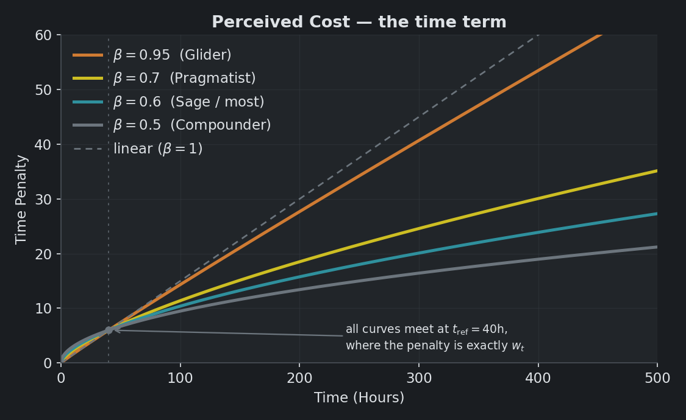

# Priority Scoring
## Overview

The priority score answers the app's central question: *what should I work on next?*

Not every node competes for that answer. Only **eligible** nodes do -- open *Learn*, *Action*, and *Resource* nodes that hold hours of their own. Goals and Milestones are each set aside for a different reason. Goals get their own ranking, while Milestones are transparent checkpoints that pass value through without competing. Containers that inherit their time are set aside too, for the reason given in [Containers Are Not Recommended](#containers-are-not-recommended). Eligibility is defined precisely in [Eligibility and the Status Cascade](#eligibility-and-the-status-cascade).

Every eligible node starts with a **base priority score**: a return-on-investment ratio of value over cost. Goal-priority boost and context weight adjust it. The suggestion list balances repetition across contexts and subcontexts while displaying underlying merit on a 0-100 scale.

The sections that follow build the score one piece at a time: intrinsic value, perceived cost, the cascade and synergies that combine into total value, and the multipliers that finish the ranking.

## Intrinsic Value

Intrinsic value ($IV$) measures how much a node is worth on its own, before its relationships to other nodes are considered. It comes from two of the user's 1–10 ratings. **Value** $V(n)$ is how big a gain the project is for the user's life, and how much of that life it reaches. **Interest** $I(n)$ is how freely the user would choose to do it. The two are kept separate because they often diverge: a project can be valuable but dull, or fun but trivial. The scoring profile sets how much each counts, through the weights $w_V$ and $w_I$.

$$ \text{IV}(n) = w_V \cdot V(n)^{\gamma} + w_I \cdot I(n)^{\gamma} $$

The exponent $\gamma$ decides how sharply the ratings separate. At $\gamma = 1$ the formula is a plain weighted sum, and a 10 counts exactly twice a 5. Sage uses $\gamma = 2$, where a 10 counts four times a 5.

The exponent is a preference transform, not objective utility. With equal weights, 10/1 yields intrinsic value 101 while 7/7 yields 98. One exceptional rating can outweigh two strong ratings.

Rate the node's own benefit where possible. Relationships explicitly represent downstream leverage. Including that leverage in the rating too can overstate it; different nodes whose meanings overlap are not automatically deduplicated.

A node with an **inherited** value mode has $\text{IV}(n) = 0$, regardless of any ratings stored for it. Such a node is a pure structural conduit: it derives its standing from its children rather than its own ratings. The cascade still flows through it, but it adds nothing on its own.

## Perceived Cost

Perceived cost is how *expensive* a node feels to complete, in terms of time and energy. It draws on two inputs: **difficulty** and **time**. The user sets the difficulty rating $D(n)$ directly. A point, range, or three-point time estimate collapses into the single value $t(n)$, as covered in [time.md](time.md).

$$ \text{Cost}(n) = 1 + w_e \cdot D(n) + w_t \cdot \left(\frac{t(n)}{t_{\text{ref}}}\right)^{\beta} $$

A leading constant, two weights, a reference scale, and an exponent shape the cost. The $1$ keeps the denominator positive even when $D$ and $t$ are both zero, as they are for a container.

Difficulty belongs to the node's own work, not to its ratings. A node that inherits its time has no work of its own, so both $D$ and $t$ count as zero. A node that inherits only its ratings keeps its own $D$, because its hours are still its own. The weights $w_e$ and $w_t$ are linear scalars, set by the scoring profile.

The reference $t_{\text{ref}}$ is a fixed constant of 40 hours. That is roughly the size of a substantial project. Time is divided by it before the exponent applies. The division gives $w_t$ a plain reading: it is the time penalty of a project that takes exactly 40 hours. A 40-hour project always costs $w_t$, whatever $\beta$ happens to be.

The exponent $\beta \in (0, 1]$ is a sublinear damper. It makes long projects feel proportionally less expensive than their raw hours suggest. That matches how people perceive effort. At the Sage default $\beta = 0.60$, a 400-hour project carries about $15.85\times$ the time penalty of a 4-hour project, not $100\times$.

Separating out $t_{\text{ref}}$ matters more than it looks. Without it the formula is $w_t \cdot t^\beta$. There $\beta$ quietly does two jobs at once. It sets the curvature of the penalty. It also sets the magnitude, because $t^\beta$ shrinks everywhere as $\beta$ falls. On a real graph, lowering $\beta$ from $0.85$ to $0.45$ shrank the whole time term by about $5.7\times$. The intent of such a change is to stop time from dominating. The actual effect was to shrink the denominator until *difficulty* dominated instead. With the reference in place, $\beta$ changes only the shape of the curve. $w_t$ alone sets its height.

$t_{\text{ref}}$ is deliberately hardcoded rather than measured from the graph. A reference taken from the live median would make every node's cost depend on the whole graph. Long projects would get quietly cheaper as work is completed. The scoring cache would also no longer be sound.

*The exponent $`\beta`$ bends the time penalty sublinearly. A lower $`\beta`$ bends harder. Every curve meets at the reference.*

The Goal ranker prices a Goal's work with this same cost, one task at a time. See [Goal Scoring](#goal-scoring).

## The DAG Cascade

Each distinct downstream beneficiary contributes through its strongest Hard/Soft route. Let $W(n,d)$ be the maximum product of edge discounts over paths from n to d. The self weight is 1; unreachable nodes contribute 0.

$$ W(n,d)=\max_{p:n\leadsto d}\prod_{e\in p}d_e $$
$$ \text{TV}_{\text{dag}}(n)=\sum_d W(n,d)\,\text{IV}(d) $$

For A -> B -> D and A -> C -> D with all Hard edges, D contributes once at $d_H^2$. B and C still contribute their own value. Capping summed weights would leave duplicate credit below the cap. Strongest-path propagation removes it at every magnitude.

Scoring reads the transitive reduction of the Hard graph. A Hard edge that a longer Hard path already implies is left out. With A -> B -> C, an extra A -> C adds no ordering, since C already waits on A. Kept, it would lift A's weight for C from $d_H^2$ to $d_H$. A task linked both to a sub-Goal and straight to its parent would likewise earn the parent at $d_H$ rather than $d_H^2$. Reachability is unchanged, so required work and Goal subtrees are too. Eligibility still reads every edge. Soft edges are never reduced.

Discounts retain their per-hop meaning. Strongest does not always mean shortest. Ties prefer fewer hops, then a Hard first hop.

Milestones are the exception: passing through one costs nothing. A Milestone tracks progress and holds no work, so it isn't a step between the work before it and the work after it. See [Milestone Transparency](#milestone-transparency). A container is different. It groups a stage of real work, so passing through one still costs a hop.

Goals are credited through their whole hard subtree. A Goal's rating pays out as its work gets done, so every task toward it counts as progress. Each task in a Goal's hard subtree counts as a direct prerequisite of it, however deep it sits. It earns the Goal at one hop's discount, $d_H$. A sub-Goal is a step, though. A parent Goal's rating mostly restates what its sub-Goals are worth, so a task under a sub-Goal earns the parent one hop further on: $d_H$ for the sub-Goal, $d_H^2$ for its parent, and so on. Nesting Goals deeper therefore adds less each level instead of a full share, so how you organize your Goals matters less. A sub-Goal you have marked Done is not a step. Tasks still open under it earn the parent at $d_H$, as if they sat under it directly. A route that enters the subtree from outside keeps the discounts it paid on the way in. So soft prep for a task in the subtree earns the Goal at $d_S \cdot d_H$. A Soft edge straight into a Goal earns it at $d_S$. The remaining-work discount below still applies, so a Goal with more work left pays less.

Done nodes are left out of the cascade. A finished node's value is already banked, so it earns nothing for the work that led to it. Routes don't pass through a Done node either. Whatever lies past it no longer waits on anything upstream of it. The sums above therefore run over unfinished beneficiaries only. The Goal ranker likewise counts only the work left.

## Remaining Required Work

Let $R(n,d)$ sum Node.time over d and its unique unfinished Hard prerequisites, excluding n. Done work and inherited-time containers contribute no hours. Hard co-prerequisites on other branches are included; optional Soft prerequisites are excluded. The self contribution has $R(n,n)=0$.

$$ q(n,d)=\frac{1}{1+(R(n,d)/H)^\delta} $$

`future_work_half_credit_hours` ($H$) is the required workload at which a benefit retains half its credit; zero disables the discount. `future_work_exponent` ($\delta$) shapes this curve independently of the immediate time-cost exponent beta. Neither is density alpha or a node count.

Profiles start at H=1300 hours. Future exponents start at 0.60 for Sage, Explorer and Creator; 0.50 for Investor; 0.70 for Pragmatist; and 0.95 for Glider. The profile sets both: Scoring settings has no control for either. These are calibration preferences, not predicted deadlines or probabilities.

At Sage's starting settings, 40 remaining hours retains 89% of a benefit's credit; 400 retains 67%; 1300 retains 50%; and 4000 retains 34%. Today's own intrinsic value stays intact. Future difficulty ratings are not summed: future work uses hours only, while today's cost includes both time and difficulty.

Discounting beneficiaries individually avoids charging the entire optional downstream graph against today's task. Shared work is counted once within each beneficiary's workload; distinct benefits remain additive. This is a priority heuristic, not a full schedule or optimal portfolio calculation.

## Synergy

Synergy edges — the Helps relationship — work differently from prerequisites. They don't say "this unlocks that." They say "doing A and B is worth doing more than doing either alone."

Take Foreign Language and Travel. Time abroad cements vocabulary in a way no classroom drill can match. Modest fluency, in turn, opens up places a monolingual tourist would struggle to navigate. Each genuinely amplifies the other, so the algorithm rewards the pairing.

Every direct partner reinforces the candidate's ordinary value through one bounded bonus. Unfinished partners receive partial credit; completed partners receive full credit in the same calculation. Partner ratings, partner DAGs, and partners of partners are never imported.

### Candidate Value and Cap

Let $B(n)$ be the candidate's unique Hard/Soft DAG value, including its own ratings, Goal credit, and the remaining-work discount, with all synergy excluded. The amount eligible for reinforcement is:

$$ A(n)=\min\left(\max(B(n),0),\;(w_V+w_I)10^\gamma\right) $$

The upper limit is the profile's maximum intrinsic node value: 200 under Sage. It scales with the profile's rating units, rather than with graph size. A project with inherited ratings can receive synergy through its ordinary downstream usefulness. A project with zero ordinary value receives no bonus.

### Partner Exposure

The existing setting names are retained: $s=d_{\text{Syn,mul}}$ is the one-completed-partner strength, and $d_{\text{Syn,pair}}$ is the one-unfinished-partner coefficient before work discount in the same context. Define $\eta=d_{\text{Syn,pair}}/s$, between zero and one. If both coefficients are zero, synergy is disabled. Custom settings with pair greater than completed strength are normalized by raising completed strength to pair; see [Versioned Settings](#versioned-settings).

For each direct partner $z$, use:

$$ a(n,z)=\begin{cases}
1 & \text{if }z\text{ is Done}\\
\left[1-(1-\eta)^{c(n,z)}\right]q(n,z) & \text{otherwise}
\end{cases} $$

The remaining-work discount uses the partner's unique unfinished Hard closure, including its own hours and excluding today's candidate's own work. It is a preference discount, not a probability of completing the partner. A blocked partner can still reinforce the candidate, with the required work reflected in its exposure.

The cross-context coefficient $c(n,z)$ is `cross_context_mult` when both nodes have known, different contexts; otherwise it is 1. A coefficient of zero disables unfinished cross-context exposure. Creator uses 3 and Explorer 2.5; the other profiles use 1. Larger coefficients increase anticipation toward the completed exposure of 1, without exceeding it. Completed exposure is independent of context.

### Bounded Reinforcement

Convert each exposure into evidence $x(n,z)$ and sum over distinct direct partners:

$$ x(n,z)=\frac{a(n,z)}{2-a(n,z)},\qquad X(n)=\sum_{z\in Y(n)}x(n,z) $$
$$ \operatorname{Syn}(n)=sA(n)\frac{2X(n)}{1+X(n)} $$

The transformation preserves the one-partner interpretation: a single exposure $a$ gives a bonus of $sA(n)a$. Several partners share one saturation curve. The bonus approaches, and never exceeds, $2sA(n)$.

| Completed partners | Bonus as a multiple of $sA(n)$ |
|---|---:|
| 0, with no unfinished partners | 0 |
| 1 | 1 |
| 2 | 1.333 |
| 5 | 1.667 |
| 10 | 1.818 |
| Arbitrarily many | Approaches 2 |

Holding the candidate's ordinary value fixed, adding a partner or finishing an existing partner cannot reduce synergy. A partner that is also a Hard/Soft beneficiary can legitimately leave the ordinary DAG calculation when completed; total priority can then fall even though partner exposure increases.

The model favors reinforcement of the candidate's own usefulness over borrowing a valuable partner's importance. A low-value companion therefore receives less promotion from a high-value partner than under the former mechanism. Reinforcement now includes the candidate's capped downstream usefulness rather than only intrinsic value, so some foundational projects gain more completed-partner credit. The ceiling and profile strengths are preference choices, not empirically calibrated joint benefits.

### Synergies are Depth-1 Relationships
Synergies do not chain or cascade the way Hard and Soft edges do. They are depth-1 relationships: only the immediate synergy partners of $n$ contribute to its score, not the partners of those partners.

There are good conceptual and algorithmic reasons for this. First, not every chain $A \leftrightarrow B \leftrightarrow C$ is meaningful. Take Cooking $\leftrightarrow$ Chemistry $\leftrightarrow$ Pharmacology. Chemistry sharpens your cooking, because you understand why acids, heat, and time matter. Chemistry also deepens your grasp of Pharmacology, since drug mechanisms are fundamentally chemical. But it doesn't follow that Cooking helps Pharmacology, or the reverse. Each link is real, yet the relation isn't transitive: the endpoints don't actually inform each other.

The second reason is performance. Helps edges are bidirectional and can form cycles, so cascading along them would either fail to terminate or fall back on path-enumeration that defeats memoization — the problem flagged in the [DAG cascade section](#the-dag-cascade). Keeping synergies at depth 1 sidesteps that entirely.

## Total Value

$$ B(n)=\sum_d W(n,d)\,\operatorname{IV}(d)\,q(n,d) $$
$$ \operatorname{TV}(n)=B(n)+\operatorname{Syn}(n) $$

A beneficiary contributes once through its strongest ordinary route. A direct Helps partner supplies reinforcement without bringing its own downstream beneficiaries into the candidate's value. Mixed prerequisite/Helps relationships retain both distinct effects.

### Attribution

Scoring and Explain share contribution records. The ordinary DAG contribution and direct reinforcement for the same node occupy one row with separate channel amounts. Every row, including completed partners, participates in the contributor sum; there is no separate completion multiplier outside the chart.

The shared bonus is allocated to partner $z$ as $sA(n)\,2x(n,z)/(1+X(n))$. These are shares of one combined bonus, not independent marginal effects. They sum to the synergy total. Explain's Value section shows one Synergy partners row. Hover identifies unfinished or finished reinforcement without claiming it imports the partner's own value.

Focus follows the largest contribution channel in a mixed row. For synergy it highlights only the direct Helps edge, including completed partners; for ordinary value it follows the strongest Hard/Soft route. It never follows a partner's downstream graph to explain a synergy bonus.

## Base Score

$$ P_{\text{base}}(n) = \frac{\text{TV}(n)}{\text{Cost}(n)} $$

The base score is return on investment in the literal sense: value per unit of cost. High value over low cost rises to the top. The rest of the algorithm adjusts this base ratio.

## Goal Priority Boost

The user may mark up to three Goals as priorities — their #1, #2, and #3 most important objectives. Marking a Goal as a priority boosts the priority score of every Hard prerequisite in its subtree. This nudges the algorithm toward the work that drives what the user has said matters most. The boost follows Hard edges only; Soft and Helps connections don't carry it.

Let $\Pi = (g_1, g_2, g_3)$ be the priority goals in rank order. From a single profile knob $b$ (the `goal_boost`), three rank multipliers are derived:

$$ \rho_1 = b, \quad \rho_2 = 1 + 0.66 (b - 1), \quad \rho_3 = 1 + 0.33 (b - 1) $$

Ranks 2 and 3 sit at two-thirds and one-third of the rank-1 premium, so they always stay proportionally between $1$ and $b$. The Sage default $b = 1.50$ gives $\rho_1 = 1.50$, $\rho_2 \approx 1.33$, $\rho_3 \approx 1.17$. The goal-driven Pragmatist uses an aggressive $b = 4.00$, which quadruples the unboosted score and raises ranks 2 and 3 in proportion.

When a node sits in multiple priority subtrees, **the highest applicable rank wins.** Formally, let $A_H(g_r)$ be the set of nodes that feed into $g_r$ via Hard edges. A node's boost is then

$$ \rho(n) = \max\big(\{1\} \cup \{\rho_r : n \in A_H(g_r)\}\big) $$

## Context Multipliers
Context weight applies after the goal boost. Suggestion variety applies after both.

### Context Weight
Each context carries a weight $w_c$, a user-configurable scalar that defaults to 1. It lets the user emphasize or de-emphasize a whole life area. For example: double the weight on Money during a tight quarter, or halve it on Humanities during a STEM stretch.

### Suggestion Variety

Task merit no longer depends on how many projects are stored in a context. Instead, each node is discounted for how many higher-ranked peers already speak for its context. This gives other areas a chance without making unrelated additions to the graph reduce a task's score.

The discount comes from a walk over the **pool**: every scorable node in the graph, Now nodes excluded. Take the node with the greatest adjusted merit, record its divisor, then charge its context and its `(context, subcontext)` pair one more repetition. Repeat until the pool is empty. Let `c` be the repetitions charged to the candidate's context when its turn comes, and `s` those charged to its pair:

`divisor(n) = (1+c)^a * (1+s)^b`

Profiles use percentages of extra merit required after **one** earlier recommendation: `p_context` and `p_subcontext` (total). Convert with `a = log2(1+p_context/100)` and `b = log2((1+p_subcontext/100)/(1+p_context/100))`. The subcontext premium includes the context premium; it is not an additional penalty and must be at least as large as the context premium.

Sage uses **5% / 15%**. After three earlier recommendations from one subcontext, another from that subcontext needs 32.25% extra merit; a sibling subcontext needs 10.25%. Accumulation grows gently. These percentages describe extra merit required, not a literal percentage subtraction from the score.

Profiles use context/subcontext premiums: Sage 5/15, Explorer 10/20, Investor 0/0, Pragmatist 2/5, Creator 5/15, Glider 5/20. The non-Sage defaults are conservative policy choices, not empirically optimized values. Both zero disables the walk and restores merit ordering.

The pool is the whole graph, never the current view. Filters, the requested row count and the Details recommendation list all narrow which nodes are *shown*; none of them changes a divisor. That is what lets one number stand for a node everywhere in the app. The cost is that a filtered list still carries discounts earned against nodes the filter hides. Now nodes are outside the pool entirely: they neither earn a divisor nor spend a repetition. Unblocking steps bypass filters and lead the list whatever they score. Goal and container ranking remain separate.

The walk uses exact merit, then exact merit and name to break adjusted ties. `(context, None)` is a broad-area bucket; identical subcontext labels under different contexts remain distinct. Legacy uncategorized nodes are exempt.

This balances a slate, not exposure over time: an unchanged graph returns an unchanged list. It does not guarantee every context a slot or periodically rotate neglected tasks.

## Final Score

Putting it all together:

$$ P(n) = \frac{P_{\text{base}}(n) \cdot \rho(n) \cdot w_c(\text{ctx}(n))}{\text{divisor}(n)} $$

A node's final priority is its ROI ratio scaled by the goal-priority boost and context weight, then discounted for repetition. Variety is part of the score rather than a re-ordering applied to a finished list. The Home tab prints the number it sorts on, so anything that moves a row has to move its number too.

The underlying merit ranking uses the unrounded score, while the figure stored and displayed is rounded to two decimals. Rounding is lossy enough to matter: on a ~450-node graph it collapses about 440 distinct scores into roughly 170, so past about rank 30 most nodes would otherwise tie with a neighbour and fall back on list order, which carries no meaning. Ordering on the exact value keeps the displayed number readable without making the sequence arbitrary.

For display, scores are linearly rescaled against the top node of the pool.

$$ P_{\text{display}}(n) = 100 \cdot \frac{P(n)}{\max_{m \in \text{pool}} P(m)} $$

Every surface that prints a 0–100 priority divides by that same base: the Home tab, the subtask tables, and Explain. A node therefore reads the same wherever it appears. Under a filter the top row can sit below 100, because the node anchoring the scale may not be on screen. Bar *length* stays relative to the longest row shown, so the column still fills its width.

The Next column descends, since the number and the sort key are now the same quantity. Pinned rows are the exception: a pin leads the list whatever it scores, and keeps its true number rather than a rescaled one.

(Explain reports this same 0–100 priority, and lists the repetition discount among its adjustments.)

## Complexity

The variety walk is a lazy-greedy over a heap of the pool. A divisor only ever grows, so a heap entry that was pushed under a smaller one is always too optimistic and is re-pushed rather than trusted. Each node is selected once and re-pushed only when its own bucket is charged in the meantime. It reuses exact scores and does not recompute graph values during the walk.

Per-source strongest-route maps replace scalar subtree sums. Per-beneficiary required-work sets and hours are cached separately. A cold route map visits its reachable DAG; subsequent candidate and synergy calculations reuse it.

Worst-case route and closure storage is quadratic. Cold preprocessing can cost O(N(N+E)); synergy aggregation additionally visits the direct partners and uses cached required-work closures. Sorting costs O(N log N). The old linear-time scalar-memo bound no longer applies; measure cold and warm performance on representative graphs.

GraphManager invalidates maps when scoring-relevant graph data changes. Future-work settings participate in its memo key. Explain computes the same contributions without retaining a stale cross-operation snapshot.

## Cycle Prevention

The memoized cascade depends on Hard and Soft edges forming a Directed Acyclic Graph. That property is enforced, not assumed. Every time the user creates an edge, the graph manager checks it for a cycle that would trap the scoring walk. If it finds one, the edge is rejected and a modal explains why.

Helps edges skip this check, by design. Synergies are [depth-1 relationships](#synergies-are-depth-1-relationships) with no recursion through them, so a cycle of Helps edges causes no problem.

## Scoring Profiles

The six built-in profiles are essentially hyperparameter bundles. The first table below lists every knob and its value under each profile. The second describes how each profile leans, and which knobs create that lean.

### Profile Hyperparameters
| Parameter | Symbol | Sage | Explorer | Investor | Pragmatist | Creator | Glider |
|---|---|---|---|---|---|---|---|
| Value weight | $w_V$ | 1.00 | 0.50 | 1.60 | 2.00 | 1.00 | 1.00 |
| Interest weight | $w_I$ | 1.00 | 2.00 | 0.40 | 0.50 | 1.00 | 1.00 |
| Rating exponent | $\gamma$ | 2.00 | 2.50 | 1.50 | 2.50 | 2.00 | 1.00 |
| Hard discount | $d_H$ | 0.60 | 0.50 | 0.92 | 0.65 | 0.55 | 0.40 |
| Soft discount | $d_S$ | 0.30 | 0.35 | 0.20 | 0.02 | 0.45 | 0.20 |
| Unfinished synergy coefficient | $d_{\text{Syn,pair}}$ | 0.10 | 0.35 | 0.02 | 0.00 | 0.60 | 0.05 |
| Completed synergy strength | $d_{\text{Syn,mul}}$ | 0.40 | 0.90 | 0.10 | 0.10 | 1.30 | 0.20 |
| Cross-context anticipation | $m_{\text{cross}}$ | 1.00 | 2.50 | 1.00 | 1.00 | 3.00 | 1.00 |
| Difficulty weight | $w_e$ | 1.50 | 1.50 | 1.00 | 1.80 | 1.50 | 3.50 |
| Time weight | $w_t$ | 6.00 | 6.00 | 5.00 | 7.00 | 6.00 | 135.0 |
| Time exponent | $\beta$ | 0.60 | 0.60 | 0.50 | 0.70 | 0.60 | 0.95 |
| Priority goal boost | $b$ | 1.50 | 1.00 | 1.00 | 4.00 | 1.00 | 1.00 |
| Same-context premium (%) | | 5 | 10 | 0 | 2 | 5 | 5 |
| Same-subcontext total premium (%) | | 15 | 20 | 0 | 5 | 15 | 20 |
| Density exponent (Goals) | $\alpha_g$ | 0.20 | 0.50 | 0.00 | 0.05 | 0.20 | 0.35 |

$w_t$ is read against the 40-hour reference, so Glider's 135 is not a typo. It is the value that produces a very steep time penalty once time is divided by $t_{\text{ref}}$.

### Two Knobs That Look Like Levers But Are Not

Anyone tuning a profile should know about two parameters that do far less than their names suggest.

Scaling $w_V$ and $w_I$ together changes nothing at all. Total value is homogeneous of degree 1 in intrinsic value. Multiplying both weights multiplies every node's score by the same constant, so the ranking is identical. Only the *ratio* between them does anything.

The ratio changes the relative influence of value and interest. Its effect depends on ratings across all reachable beneficiaries, not only the candidate's own ratings. Future-work settings also change relative priority by controlling how strongly distant required work discounts downstream benefits.

Completed partners have full exposure; unfinished partners have partial exposure in the same bounded bonus. Profile differences should be assessed against current recommendations rather than a fixed target for top-ten overlap.

### The Perspective of Each Profile
| Profile | Perspective | Parameter Tweaks |
|---|---|---|
| **Sage** | The reference baseline. A balanced ranking that leans no particular direction, landing near the graph's own median on time, value and interest alike. | All other profiles are expressed as deltas off these defaults. |
| **Explorer** | Curiosity-driven. Favors what you find interesting, rewards cross-domain links, and gives sparse contexts a fair shot. | $w_I$ set to four times $w_V$, and the highest $\gamma$ of any profile so those ratings bite hard. Synergy parameters raised far enough that $m_{\text{cross}} = 2.5$ actually registers. The 10%/20% premiums encourage a wider recommendation list. $b = 1.0$ switches off the goal boost, since goals are not the point here. |
| **Investor** | Foundational depth. Work that unlocks long prerequisite chains, whether or not it is enjoyable. | The lowest $\gamma$ of the rating-driven profiles, deliberately: this profile is about structure, so ratings should not drown out reach. $d_H = 0.92$ carries value far along *hard* chains. $d_S = 0.20$ keeps soft links from flooding value everywhere. That contrast is what selects unlock-heavy nodes, and a high $d_S$ would erase it. Zero repetition premiums let deep contexts win on merit. |
| **Pragmatist** | Goal-driven execution. What you said matters most should dominate, and distractions should not surface at all. | $w_V$ set to four times $w_I$. $d_S = 0.02$ all but removes soft prerequisites, and unfinished synergy anticipation is zero. $b = 4.0$ makes the priority-goal boost decisive. |
| **Creator** | Synthesis and cross-disciplinary work. Rewards pairings that blend across domains. | $d_{\text{Syn,pair}} = 0.60$ and $d_{\text{Syn,mul}} = 1.30$ are the largest of any profile. The $m_{\text{cross}} = 3.0$ coefficient raises cross-context anticipation toward full reinforcement; all partners still share the cap. |
| **Glider** | Light, varied, low-friction work. For seasons when you need to coast. | $\gamma = 1$ keeps ratings plain and linear — no need to agonise over them while coasting. Every cost knob raised so heavy work is penalized hard: $w_e = 3.5$, a very large $w_t$, and $\beta \to 0.95$ to keep the penalty close to linear in hours. Cascade and synergy contributions damped. $b = 1.0$ disables the priority-goal boost so non-priority work competes fairly. |

Profiles express different preferences; disagreement alone is not evidence of quality. Compare recommendations after structural changes before retuning profile weights.

## Worked Example

A and downstream D each have Value 5 and Interest 5 under Sage: intrinsic value 50 each. A has difficulty 5 and 40 own hours. D directly requires A and has 1300 own hours, with no other relationships.

A's cost is 1 + 1.5 * 5 + 6 * (40/40)^0.6 = 14.5. Its own value contributes 50. D contributes 0.6 * 50 * 0.5 = 15. Total value is 65, giving base priority 65/14.5 = 4.48 before context and goal adjustments.

# Goal Scoring

Goals describe capacities built from prerequisite work. They get their own ranking rather than competing with tasks. A Goal ranks by the average worth of the work left beneath it.

The Goals sidebar helps you choose which Goals to make priorities. Priorities then decide what matters right now. So the ranking itself reports how good a Goal's remaining work is, by your own ratings. It doesn't favor big Goals or small ones.

## The Work Beneath a Goal

A Goal's work is every unfinished task in its hard subtree. That is every node with a chain of Hard edges leading into the Goal. Soft prep and Helps partners aren't part of it. Finished work isn't either.

A task is a node with hours of its own. Sub-Goals, Milestones and containers that inherit their time hold no work of their own. Their work is the tasks beneath them.

Every task counts alike, however deep it sits. A task five steps below a Goal is as much progress toward it as one directly beneath it.

## What a Task Is Worth

A task is worth its own ratings plus the credit it earns for the Goals it serves. That credit follows the same rule as the [cascade](#the-dag-cascade). A task earns $d_H$ of its nearest Goal's rating, and one more $d_H$ for each parent Goal above that. Let $\gamma(n)$ be the Goals above task $n$ and $k(n,g)$ the number of Goal levels from $n$ up to $g$, counting its nearest Goal as 1. Then:

$$ w(n) = \text{IV}(n) + \sum_{g \in \gamma(n)} d_H^{\,k(n,g)}\,\text{IV}(g) $$

A task is worth the same whichever Goal counts it. What it unlocks isn't added, because that work is counted in its own right. Credit pays out as the work gets done, so the future-work discount doesn't apply.

## Goal Score

Let $R(g)$ be the unfinished tasks in Goal $g$'s hard subtree. Its base score is their total worth over their total cost:

$$ P_g(g) = \underbrace{\frac{\sum_{n \in R(g)} w(n)}{\sum_{n \in R(g)} \text{Cost}(n)}}_{\text{Base Score}} \cdot \underbrace{\rho(g)}_{\text{Goal Priority}} \cdot \underbrace{w_c(\text{ctx}(g))}_{\text{Context Weight}} \cdot \underbrace{\delta_g(g)}_{\text{Goal Density}} $$

$\text{Cost}(n)$ is each task's ordinary [perceived cost](#perceived-cost). A Goal with no work left scores 0.

The base score is an average, so size is handled by an explicit rule. A Goal's size counts neither for nor against it. Adding more work of the same quality leaves its score unchanged. How the work is drawn doesn't matter either. A chain of tasks scores the same as the same tasks linked straight to the Goal.

A Goal's own rating enters through the credit each of its tasks earns. A Goal you rate highly lifts all of its work. A sub-Goal is a step on the way up. A parent Goal's rating mostly restates what its sub-Goals are worth, so it counts one $d_H$ less.

A Goal's priority keeps the rank boost, context weight and its own density correction. Suggestion variety does not change Goal ranking.

Goal density is bucketed by Goal headcount alone. Let $B_g(g) = (\text{ctx}(g), \text{subctx}(g))$ be the Goal's bucket. Let $|B_g(g)|$ be the count of **open** Goals sharing that bucket. Done Goals are excluded, since they aren't competing for sidebar attention. Then:

$$ \delta_g(g) = \frac{1}{\max(1,\, |B_g(g)|)^{\alpha_g}} $$

Goal density has its own exponent, alpha_goal: Sage 0.20, Explorer 0.50, Investor 0, Pragmatist 0.05, Creator 0.20, and Glider 0.35. These settings are unchanged by v3 and v4. Zero disables the correction.

Why count only Goals? A heavily decomposed area produces both more leaves *and* more Goals. If Goals shared the leaf bucket count, a Goal in that area would be penalized for the leaves it happens to sit next to. Counting only Goals isolates the relevant question: "how crowded is the sidebar within this corner of the graph?"

> [!NOTE] Note
> The Goals sidebar, the Analyze tab's Goals chart and the Details suggestions all rank Goals by the priority ranking explained here. Wherever a Goal shows a 0-100 priority, 100 is the top score among unfinished Goals. A Goal is unfinished until it is Done or every hard prerequisite beneath it is. Searches and filters never move that base.

## Why an Average

Two other rules were measured on a real graph in September 2026 and set aside.

Summing a Goal's work ranks Goals by size. Worth grows with every task, while cost grows more slowly, so the largest Goals win. The earlier ranker kept this in check by discounting each task by its steps from the Goal. That made the score depend on how the Goal was drawn. A highly rated Goal whose work sat in a chain of stages ranked 58th of 60, and 2nd once the same tasks were linked straight to it.

Scoring a Goal by the next work it would pull up fails because Goals share their best tasks. Six Goals opened with the same two tasks, so the sidebar would have repeated the Home tab. That question belongs to priorities: the boost lifts a Goal's best next work.

## Milestone Transparency

A Milestone marks an achievement, not the effort to reach it. "10 strict pull-ups" is a line you cross, not a thing you practice. The practice lives in the capacity nodes that lead up to it.

This creates a problem for Goal ranking. A Milestone often sits mid-tree, between a Goal and the real work beneath it. If it carried its own value and time ratings, those numbers would enter the Goal's score as though the checkpoint were itself a body of work.

So the app treats every Milestone as transparent. Its own value and time are set to zero, so it contributes nothing of its own to the score. It isn't a step either. Value passes through it with no discount, so the work on either side of a Milestone is as close as if the Milestone weren't there. In the Goal ranking, the tasks beneath a Milestone count like any others.

# Containers Are Not Recommended

A node with `time_mode = inherited` draws its time estimate from its hard prerequisites rather than holding hours of its own. Such a node is never recommended on the Home tab.

The reason is that two rules point at the same set of nodes. Time inheritance draws from a node's hard prerequisites. Eligibility requires every hard prerequisite to be Done. So at the exact moment such a node becomes rankable, every hour it inherited has already been spent. There is nothing left to work on, only a box to tick.

Ranking it anyway produces a bad recommendation twice over. Its cost carries no time term at all, so it undercuts the whole pool on price. Its total value still collects the full cascade from everything it unlocks. Value of a subtree divided by the cost of nothing puts it near the top of the list: on a ~450-node graph, such a node landed in the top five the moment it unblocked.

The exclusion keys on **time alone**, deliberately. A node with inherited *ratings* but its own hours is a different case: it has real work to do and merely draws its worth from what it unlocks, so it keeps competing normally. It also keeps its own Effort, which prices that work.

Excluded nodes are left out of the list, not out of the graph. Cascade still flows through them untouched, so they remain connective tissue. The Details tab suggests Goals in its own list, ranked by the Goal scoring above.

# Eligibility and the Status Cascade

Both scoring algorithms above consult three independent state fields on each node:

| Field | Values | Source | Effect on scoring |
|---|---|---|---|
| Status | Open, Blocked, Done | The user's Done-flips, plus the graph's structure | Decides which nodes are eligible to be scored, and what counts as remaining work in the Goal ranking. |
| Dormant | 0 or 1 | User-set, or cleared when an Event triggers | A Dormant node is left out of scoring until its Event fires. |
| Now | 0, or a rank | User-set | Positive values double as the card order in the Now section. Still scored, so its breakdown shows in Explain. But it doesn't compete for the top $n$ slots in the Home tab. |

Status is the most algorithmically substantive of the three. The rest of this section concentrates on it: its formal definition, the cascade that maintains it, and the invariants that cascade depends on. Dormant and Now sit outside that machinery, and are covered at the end.

## The Status Function

The user directly controls only one of the three values: Done, via the toggle on each node. Blocked and Open are derived from the graph's structure.

$$ \text{status}(n) = \begin{cases} \text{Done} & \text{user marked Done} \\ \text{Blocked} & \text{at least one hard need not done} \\ \text{Open} & \text{otherwise} \end{cases} $$

Goals are exempt from this function. Their status is user-controlled and never recomputed. This keeps their "yellow star" look on the canvas, which makes Goals easy to spot. It also lets the user decide for themselves when a Goal is met.

## Status Cascade

Marking a node Done can unblock the nodes that depended on it. A node is Blocked while any of its hard prereqs is unfinished. Complete the last one, and the node becomes Open.

The app doesn't recompute the whole graph on every flip. It walks forward instead. Starting at the node you just changed, it visits each Hard dependent and rechecks its status. If that status changed, the walk continues to that node's own dependents. If it didn't, the walk stops there.

Two properties keep the walk computationally light:
- **Hard Edges form a DAG.** Cycle prevention at edge-insert time guarantees the walk always terminates.
- **Short-circuit on no-change.** If a node's recomputed status matches what it already had, the cascade stops.

In short, the cascade proceeds only as far as it needs to.

## Done is Final

Once a node is Done, the cascade will never silently flip it back to Open. A Done node moves only when one of its hard prereqs stops being Done. That happens when the user un-completes a prereq, or gives the node a new hard prereq that isn't Done (in the node editor, or from the link menu). Either way it goes to Blocked, not Open, and the app warns before the change.

A Done Milestone never moves at all. A Milestone records a result, not work. You can mark one Done while the work before it is unfinished, because you hit the target early. And reopening that work later doesn't take the result back. Whatever the Milestone unlocks stays unlocked.

## Startup Safety Net

On every app launch, the graph manager walks every non-Goal node. It re-derives each status from the current Hard prereqs, corrects any drift, and logs what it fixed. Drift can only happen if you add nodes directly with SQL, bypassing the app's safety mechanisms.

The event manager runs a second pass immediately afterwards, over the Dormant flag. It wakes any node whose event rows say it already activated, and logs what it fixed. It only ever wakes, never sleeps: an activated row is a firing that happened, so honouring it cannot lose information, while sleeping on the strength of a missing row could pull a node off the canvas behind your back.

## Dormant and Now Nodes

The status function covers the three lifecycle values: Open, Blocked, and Done. Two extra flags also affect what the scoring algorithm sees. Neither is part of the cascade, because neither needs to be. Dormant and Now don't ripple through the graph the way status does, so nothing has to keep them consistent.

**Dormant** nodes are excluded from every read path in the scoring pipeline. When an Event triggers a Dormant node, the flag clears. The status cascade then runs to settle whether the newly-live node is Open or Blocked.

The flag is one bit per node, stored apart from the node's event row. That is why it is re-derived on every write to the event-node table rather than set by whichever caller happened to arrive. [skilltree/store/events.py](../skilltree/store/events.py) owns the rule and the paths that maintain it.

**Now** nodes still cascade and still receive a final score, which the Explain modal uses. But the Home tab keeps them out of the Suggestions ranking, surfacing them in a separate Now panel instead.

A Now node that can't be recommended at all — one carrying a negative score, so Blocked, a Goal, a Milestone, or otherwise ineligible — pins **unblocking steps** above the ranking instead. These are the highest-scoring nodes in its transitive `Needs_Hard` prerequisite subtree that are themselves startable. The steps are a selection over scores already computed, not a scoring rule: no divisor changes, no number moves. They bypass the user's filters, they are never repeated in the ranking below, and they are added above the requested row count rather than taken out of it.

# Symbol Glossary

Every symbol used above, collected for reference.

## Edges

| Symbol | Description | Directed |
|---|---|---|
| $E_H$ | Hard prerequisites — the source must be Done before the target can be worked on | Yes |
| $E_S$ | Soft prerequisites — the source is helpful but not strictly required for the target | Yes |
| $E_Y$ | Helps relationships — mutual synergy between two nodes | No |

The full edge set is $E = E_H \cup E_S \cup E_Y$. An edge $A \to B$ means $A$ is a prerequisite for $B$.

## Node Attributes

| Symbol | Range | Meaning |
|---|---|---|
| $V(n)$ | $\{1, \ldots, 10\}$ | Value rating |
| $I(n)$ | $\{1, \ldots, 10\}$ | Interest rating |
| $D(n)$ | $\{1, \ldots, 10\}$ | Difficulty (Effort) rating |
| $t(n)$ | $\ge 0$ | Point estimate for time, in hours |
| $\text{status}(n)$ | $\{\text{Open}, \text{Blocked}, \text{Done}\}$ | Lifecycle state |
| $\text{ctx}(n)$ | string or null | Context |
| $\text{subctx}(n)$ | string or null | Subcontext, a sub-area within a context |

## Adjacency Maps

| Symbol | Definition | Meaning |
|---|---|---|
| $H_{\text{out}}(n)$ | $\{m : (n, m) \in E_H\}$ | Nodes $n$ unlocks via Hard |
| $S_{\text{out}}(n)$ | $\{m : (n, m) \in E_S\}$ | Nodes $n$ unlocks via Soft |
| $H_{\text{in}}(n)$ | $\{m : (m, n) \in E_H\}$ | Hard prereqs of $n$ |
| $S_{\text{in}}(n)$ | $\{m : (m, n) \in E_S\}$ | Soft prereqs of $n$ |
| $Y(n)$ | $\{m : \{n, m\} \in E_Y\}$ | Synergy partners (symmetric) |

## Derived Quantities

| Symbol | Meaning | Defined in |
|---|---|---|
| $\text{IV}(n)$ | Intrinsic value | [Intrinsic Value](#intrinsic-value) |
| $\text{Cost}(n)$ | Perceived cost | [Perceived Cost](#perceived-cost) |
| $\text{TV}_{\text{dag}}(n)$ | Unique strongest-route value before future-work discount | [The DAG Cascade](#the-dag-cascade) |
| $\operatorname{Syn}(n)$ | Bounded synergy bonus | [Bounded Reinforcement](#bounded-reinforcement) |
| $A(n)$ | Candidate value eligible for reinforcement | [Candidate Value and Cap](#candidate-value-and-cap) |
| $\text{TV}(n)$ | Total value | [Total Value](#total-value) |
| $P_{\text{base}}(n)$ | Base score (ROI) | [Base Score](#base-score) |
| $\rho(n)$ | Goal-priority boost | [Goal Priority Boost](#goal-priority-boost) |
| $w_c$ | Context weight | [Context Weight](#context-weight) |
| `a`, `b` | Repetition exponents | [Suggestion Variety](#suggestion-variety) |
| $P(n)$ | Final score | [Final Score](#final-score) |
| $w(n)$ | A task's worth to the Goal ranker | [What a Task Is Worth](#what-a-task-is-worth) |
| $P_g(g)$ | Goal score | [Goal Score](#goal-score) |

Profile hyperparameters ($w_V$, $w_I$, $d_H$, $d_S$, $d_{\text{Syn,pair}}$, $d_{\text{Syn,mul}}$, $m_{\text{cross}}$, $w_e$, $w_t$, $\beta$, $b$, $\alpha_g$, and suggestion premiums) are listed in [Profile Hyperparameters](#profile-hyperparameters).

## Versioned Settings

Schema v6 unifies synergy. The existing `d_Syn_pair`, `d_Syn_mul`, and `cross_context_mult` keys remain, with the meanings above. Named profiles retain their numeric defaults. V5 tool overrides retain every unrelated preference; if pair exceeds completed strength, completed strength is raised to pair, including formerly pair-only configurations. Anticipation therefore remains finite and cannot exceed completion. Invalid negative or non-finite synergy parameters are rejected. Reads normalize in memory without writing; `set_hyperparams` stamps v6.

Schema v5 made named profiles authoritative for ordinary Settings saves. Pre-v5 stored snapshots are ignored so they cannot hold back profile retunes. Deliberate v5-and-later tool overrides continue to override the selected profile.

Schema v4 retires task alpha and adds suggestion premiums. Existing named profiles receive their new defaults; legacy custom bundles receive Sage defaults unless explicit premiums are stored. Reads do not write settings. Goal density and future-work settings are preserved.

Schema v3 intentionally changes cascade and Goal scope and adds future-work controls. V1 bundles without a rating exponent retain 1; v2 bundles without one retain 2. The old task time-cost coefficient is rescaled only for v1, never again for v2/v3. Reads migrate in memory; saving stamps the version.

V2's Goal reference was an intentional retune: one shared coefficient cannot preserve both old task and Goal curves with different reference scales. V3 leaves immediate cost and density defaults unchanged.

# Navigation
## Tutorial
Next on the technical path is **Time**, which explains the time estimate $t(n)$ that the scoring math here takes as a given. After that, both routes converge on **Modeling**.

  <a href="../README.md">README</a> · <a href="features.md">Features</a> · <b>Scoring</b> · <a href="time.md">Time</a> · <a href="modeling.md">Modeling</a>

## Other Resources

| Resource | What's there |
|---|---|
| [skilltree/domain/scoring.py](../skilltree/domain/scoring.py) | The functions behind this document: `build_adjacency`, `total_value`, `score_nodes`, `explain_score`. |
| [skilltree/store/graph/manager.py](../skilltree/store/graph/manager.py) | The state gateway that runs the status cascade and caches scores. |
| [app_architecture.md](app_architecture.md) | Where scoring sits in the app. The layering, the state gateway, and the mutation-to-rerank flow. |
